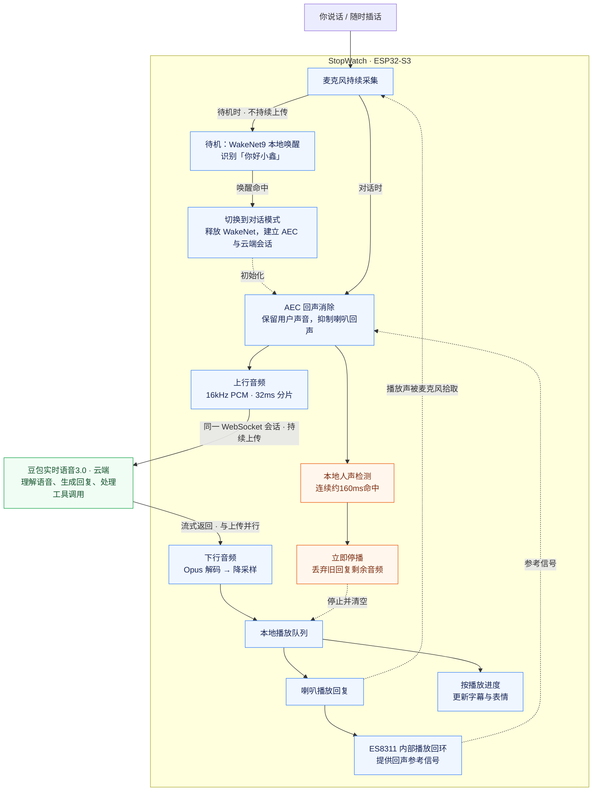
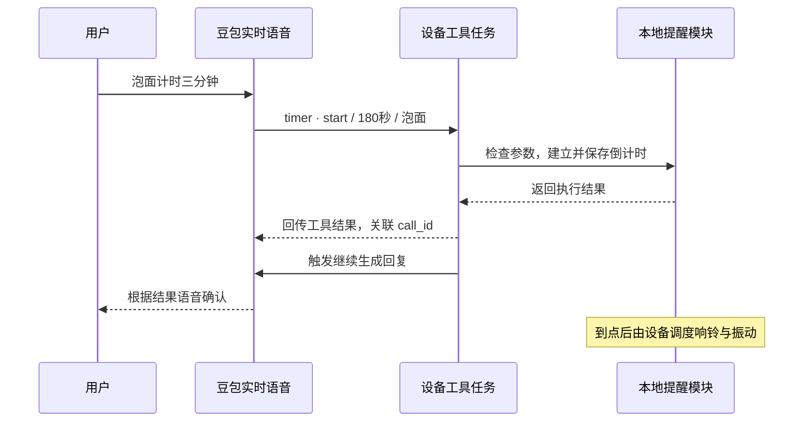

## 题记
之前折腾过[GPT语音助手](/2025/12/16/gptspeaker/)，也让[Vector听中文、说中文](/2026/09/20/vector-speaks-chinese/)。这次想把语音助手做得再小一点，顺便给它一张脸：叫它的时候会睁大眼睛，听你说话的时候盯着你，思考时变成三个点，讲笑话时自己也会笑。

正好M5Stack的StopWatch把圆形AMOLED屏幕、麦克风、喇叭和电池都装进了一个小小的表壳里。硬件现成，剩下的就是换上自己的固件，直连豆包实时语音，再让屏幕上的小家伙动起来。

于是有了**stopwatch-doubao**。唤醒词是「你好小鑫」，那就叫它小鑫吧。


## 先看效果
把小鑫的一天做成了一段视频：早上叫起床、听新闻，中午帮泡面计时，下午控制家里的灯，晚上讲笑话、练英语，最后说声晚安。

<div style="position:relative;width:100%;aspect-ratio:16/9;">
<iframe src="https://player.bilibili.com/player.html?bvid=BV1dtaB6JEBk&p=1&autoplay=0&high_quality=1&danmaku=0" title="你好小鑫：StopWatch豆包AI语音助手" style="position:absolute;top:0;left:0;width:100%;height:100%;border:0;" scrolling="no" allowfullscreen="true" sandbox="allow-top-navigation allow-same-origin allow-forms allow-scripts allow-popups"></iframe>
</div>

> 播放不了的话，可以[到B站观看](https://www.bilibili.com/video/BV1dtaB6JEBk/)。

视频用3D手表和情景对白介绍功能，头像动画来自固件里的同一套引擎。上面的照片是实物；下面聊聊这些功能在小板子上是怎么做出来的。

## 一块表能做什么
最基本的用法是喊一句「你好小鑫」，然后直接聊天。也可以按侧键或点屏幕开启对话，问天气、聊新闻，或者让它陪你练几句英语。联网搜索需要另外配置相应的服务凭证。

除了聊天，还给它接了几件日常会用到的事：

* **闹钟、计时和秒表**：用中文说时间，提醒保存在本机，到点有声音和振动，也支持重复闹钟；
* **跨会话记忆**：对话原文和长期摘要保存在设备上，下次聊天能带上之前的上下文；
* **设备设置**：音量、屏幕亮度、头像颜色都可以用语音调整，「换成粉色」就能换一张粉色的脸；
* **Home Assistant**：通过工具查询家里的设备状态，并提供控制接口。视频里的关灯是情景演示，仓库记录已经验证了状态查询，实际设备控制还需要继续实测。

表盘默认只有头像，没有文字。想看时间、电量和提醒，就从屏幕顶部往下拉；对话时拉下来，还能看自己的话和回复字幕。从底部往上滑，再把整块屏幕还给那张脸。

## 硬件不用从头焊
这次用的是M5Stack StopWatch，主要配置如下：

| 部件 | 配置 |
|---|---|
| 主控 | ESP32-S3R8 |
| 屏幕 | 1.75寸圆形AMOLED，466×466 |
| 音频 | ES8311音频芯片、单麦克风、1W喇叭 |
| 操作 | 触摸屏、两个侧键 |
| 提醒 | 喇叭和振动马达 |

固件用ESP-IDF 5.5和C++写，文字界面用LVGL 9。**语音识别、模型思考和语音合成都在云端**，手表负责采集、播放、回声消除、打断和显示，通过WiFi直连豆包实时语音服务，不需要另起一台语音中转服务器。

这也意味着聊天依赖网络和云端服务。它没有电池RTC，重启后要先联网校时，提醒调度才会开始；不能把它当成一块断网也能放心叫醒人的普通闹钟。

## 小鑫的大脑：豆包实时语音模型3.0
目前接的是**豆包实时语音模型3.0（Seeduplex，全双工版）**。它是端到端的语音到语音模型：持续接收音频，也能流式输出语音，在对话过程中处理用户的插话。模型能力和接入协议可以看[火山引擎官方说明](https://docs.volcengine.com/docs/DoubaoVoice/access-mustread?lang=zh)。

以前做语音助手，通常要自己把「语音识别 → 文本大模型 → 语音合成」三段串起来，每段都要处理等待、缓冲和打断。这里由实时语音服务统一处理语音理解与回复生成，设备接收返回的音频、转写和工具事件。问天气、设计时器、查家里设备时，模型发起工具调用，手表执行后把结果回传，再继续回答。

产品名称和接口里的模型编号是两回事：当前固件在创建会话时传入的`model`是`1.2.6.1`，具体接入配置以源码和服务端文档为准。ESP32上运行的是唤醒与音频处理所需的小模型，豆包这个语音大模型运行在云端。

## 「你好小鑫」：先在本地叫醒它
唤醒用的是esp-sr的**WakeNet9**，在ESP32本地识别「你好小鑫」。待机时麦克风持续采集，音频送给本地唤醒模型；默认不保持豆包预连接，也不把待机录音持续上传给豆包。命中唤醒词以后，才切换到对话状态、建立云端会话，开始实时音频收发。

这里还有一个内存取舍：WakeNet大约需要24KB内部RAM，AEC大约需要76KB。为了给WiFi、TLS和音频缓冲留空间，**两者按状态轮换**：待机保留唤醒模型，进入会话时销毁唤醒模型、建立AEC，结束对话后再恢复唤醒。已经在聊天时直接说下一句即可，不用每句都喊「你好小鑫」。

想换唤醒词，要选相应的WakeNet模型并重新构建固件。`VOICE_WAKE_PHRASE`只负责界面提示文字，改成另一个名字并不会让模型自动学会那个词。按键和点屏幕也能开启对话，不一定要用语音唤醒。

## 最难的是：它说话时，你也能说话
接上语音接口，让设备听一句、答一句，比较容易。真正费时间的是**它正在说话的时候，你插一句，它能听见并停下来**。

全双工首先要让录音和播放同时工作：小鑫回答时麦克风继续采集，经过回声消除后的声音仍然往云端送。一次唤醒建立一条WebSocket会话，在同一会话里持续传音频和接收回复，不用每聊一句就重新连接。

这条链路可以拆成两路看：

* **上行**：麦克风采集 → 本地回声消除 → 16kHz单声道PCM，按32毫秒分片 → WebSocket持续上传；
* **下行**：云端流式语音 → 接收队列 → Opus解码、降采样 → 播放队列 → 喇叭，同时按播放进度更新字幕和表情。

两路并行运行。云端负责理解语音和决定对话节奏，设备负责把声音按时送到，并在插话时及时让喇叭停下来。**模型支持全双工，还需要整条音频链路配合，才能变成用起来顺畅的实时对话。**



蓝色是设备上的音频链路，绿色是云端模型，橙色是插话时的本地停播流程。麦克风在待机和对话时分别走唤醒检测、AEC上行两条路径；两种模式轮换，WakeNet与AEC不同时驻留。停播只清掉旧回复，麦克风和上行继续工作，用户的新一句话仍会送给云端。图中的160毫秒是本地检测门槛；每次会话第一句回复的前3秒还要等待AEC收敛，暂不启用本地打断。

这么小的表壳，喇叭就在麦克风旁边。没有回声消除，小鑫很容易把自己的回答当成你说的话，接着自己跟自己聊。

这里用esp-sr做本地回声消除，参考信号取自ES8311内部的播放回环。踩过的一个坑是：回声压得更干净，不一定更适合对话。一开始选的模式在双方同时说话时，也把用户的声音压坏了，听起来有声音，送给识别却认不出来。最后换成适合全双工的FD模式，再实际听上行录音、检查转写结果。

第二个坑是网络。服务端发语音的速度比播放快得多，直接收PCM，大块下行数据会挤住上行录音。结果就是它在说，你也在说，但你的话过了好一会儿才送出去。改用Opus压缩音频，把接收和解码拆开，再分开WebSocket的收发锁，上行才能按实时节奏持续发送。

最后还是加了**本地先停播**：在回声消除后的音频上检测人声，连续约160毫秒命中，就先停掉喇叭、丢弃旧回复剩余的音频，让云端继续识别用户的新一句话。这个数字是本地检测门槛，不是整段对话的响应延迟。

提示词也要配合：明确告诉模型，用户在它说话时发言，即使只是「停」「等一下」，也要让出话轮、倾听新请求。当前豆包实现没有在本地停播时直接发送`response.cancel`，因为实测这样会让后续识别卡住；先停止本机播放、继续上传用户语音，是这版固件验证后采用的处理方式。

目前也有边界：每次会话刚开始，回声消除需要收敛，第一句回复的前3秒暂时不能打断；偶尔仍会误判，把回答截掉。比起只看“全双工”三个字，这些实际听感更值得继续调。

## 给语音助手装上一张脸
头像来自[bloub](https://github.com/jeremy-prt/bloub)，作者用SVG复刻了一套Grok风格的机器人形变动画。我把它的形变引擎移植成C++，在ESP32上直接画出来。

圆形AMOLED很适合这个小家伙：黑色背景不发光，中间一颗彩球，两只白眼睛。待机时眨眼，叫醒时睁大眼睛，听的时候转过来看你，想的时候缩成三个点。再加上16种表情，同一句回答配上开心、困惑或者得意的眼神，感觉就不一样了。

下面几组循环动画用固件里的同一套形变引擎导出，能直接看到小鑫怎么换表情：

<div style="display:grid;grid-template-columns:repeat(3,minmax(0,1fr));gap:12px;max-width:720px;margin:20px auto;text-align:center;">
<div><p>听你说话 → 思考</p></div>
<div><p>开心 → 大笑</p></div>
<div><p>好奇 → 困了</p></div>
</div>

表情还要和声音对得上。云端返回的文字往往比语音播放快，如果文字一到就换脸，它已经开始笑了，喇叭却还在说上一句。

现在让模型用emoji标记回复的情绪，设备识别后从字幕里去掉，再按语音播放进度推进字幕和表情。这样说到那句话时，才换成对应的脸，也不用每句话都额外调用一次工具来报告心情。

**小屏幕并不等于好画。** 全屏的球一形变，就要重画十几万像素，还得和录音、播放抢资源。最后把头像放到独立任务，只刷新真正变化的区域，通常只重画眼睛；全屏头像直接通过小块DMA缓冲上屏，拉出信息层时再交给LVGL叠文字。目标是让头像保持30fps，同时给音频留出优先级。

bloub的代码采用MIT许可，原作者是Jérémy Perret；头像设计来源也应单独说明。这个项目与x.ai无关。

## 不只聊天：让模型调用工具办事
能说「三分钟后叫你」，还得真的三分钟后响铃。这里用的是**Function Calling（工具调用）**：把设备能做的事情注册给模型，模型理解用户的意思后给出工具名和参数，固件执行具体动作，再把结果回传，让它根据执行结果回答。

目前固件定义了下面这些工具；Home Assistant的两个工具只在配置`HA_TOKEN`后注册，其余随固件初始化注册。

| 工具 | 能做什么 | 可以怎么说 |
|---|---|---|
| `get_weather` | 查询当前天气和未来三天预报 | 「杭州明天会下雨吗？」 |
| `get_system_info` | 查询日期时间、电量与充电状态、音量、亮度、网络、芯片温度和内存 | 「还有多少电？」 |
| `set_volume`、`set_brightness` | 设置百分比，或者调高、调低一档 | 「声音小一点」「亮度调到50」 |
| `set_avatar_color` | 用颜色名或`#RRGGBB`换头像颜色 | 「换成粉色」 |
| `alarm` | 设置、查询、取消闹钟，支持单次、每天、工作日和周末 | 「工作日早上七点半叫我」 |
| `timer` | 开始、查询和取消倒计时 | 「泡面计时三分钟」 |
| `stopwatch` | 开始或继续、暂停、记圈、归零、查询用时 | 「开始秒表」「记一下」 |
| `home_query` | 按设备名或房间名查询HA设备状态、传感器读数 | 「客厅灯开着吗？」 |
| `home_control` | 提供开关、亮度、温度、风速、窗帘位置等控制接口 | 「把客厅灯关了」 |

这张表介绍的是源码提供的能力，不代表每种组合都已实机验证。尤其是Home Assistant控制、重复闹钟跨天行为和部分提醒场景，还需要继续补测。联网搜索和唱歌则是豆包会话中的云端扩展能力，没有注册成上述本地工具。

### 一句「泡面计时三分钟」，怎么变成计时器
每个工具有名字、用途说明、JSON Schema参数定义和一个C++执行函数。创建云端会话时，把这份工具清单一起发给模型。模型看到「三分钟」，会把它转换成总秒数，生成这样的调用参数：

```json
{
  "name": "timer",
  "arguments": {
    "action": "start",
    "seconds": 180,
    "label": "泡面"
  }
}
```

这是参数示例，实际协议事件还带有`call_id`等字段，用来把返回结果对应到这一次调用。设备按工具名分发给提醒模块，检查时长、建立倒计时并保存提醒；后续由本地调度器负责到点响铃，不需要模型在云端一直数180秒。



实现上还有两个容易踩的地方。首先，天气和HA查询可能要等HTTP返回，**工具放在单独的FreeRTOS任务里执行**，不能在WebSocket收包回调里等，否则收音频和处理事件都容易被拖住。其次，在当前豆包接入里，回传工具结果只是把它放进上下文，还需要发送`input_audio_buffer.commit`触发后续回复。固件用`conversation.item.create`回传`role=tool`的结果，再让模型开口确认。

工具说明和提示词也得写清楚：设置音量、亮度、提醒和家电时，必须实际调用工具，只有执行成功才能说「调好了」。模型偶尔仍会跳过工具直接回答，所以调试时要同时看串口里的调用与返回结果，不能只听它有没有说“成功”。

### 天气和智能家居，怎么接到小板子上
天气工具通过HTTP调用Open-Meteo，先把城市名转换成经纬度，再获取天气数据，整理成简短文本回传。没说城市时，通过网络出口IP推测本地城市，并不是用GPS定位。

Home Assistant则由固件带着配置好的令牌访问REST API。为了少收、少解析数据，没有直接拉整份`/api/states`，而是通过`/api/template`只取相关设备的名称、状态和必要属性，返回紧凑文本。模型只需填「客厅灯」这样的中文名，固件再做名称匹配，找到实际的`entity_id`；控制时根据设备类型和动作调用对应的`/api/services`接口。

本机设置更直接：音量和亮度调用设备控制接口，头像颜色交给渲染模块，设置保存到NVS。闹钟和计时交给提醒模块，提醒数据保存到SPIFFS。模型负责理解自然语言，真正改状态、存数据和操作硬件的是这些本地模块。

后续接入GPT-Live或Gemini Live时，这些执行函数可以复用，需要重新适配的是工具声明、调用事件和结果回传协议。

## 电源管理：安静待机，用时再忙起来
小鑫要一直听唤醒词，但不能一直按聊天时的功耗跑。现在按工作状态调整CPU频率、WiFi和音频供电：

| 状态 | 电源管理方式 |
|---|---|
| 待机等唤醒 | CPU动态调频，空闲时可降到80MHz；WiFi使用MAX_MODEM省电模式，默认不保活云端预连接 |
| 实时对话 | CPU锁定240MHz，WiFi切到MIN_MODEM，优先保证音频收发的实时性 |
| 播放声音 | 按需开启5V升压和功放，先开升压、等待20毫秒再开功放，减少爆音；停播2秒后关闭 |
| 长时间没操作 | 待机20秒调暗屏幕，120秒熄屏；熄屏后停止头像绘制，降低界面轮询频率 |

熄屏以后，本地唤醒仍然在听。唤醒词、按键、触摸和到点提醒都能点亮屏幕；**熄屏不等于整机睡眠**。当前固件没有开启light sleep，因为持续的I2S音频采集和USB串口限制了这条省电路径。

默认的`VOICE_WARM=0`选择唤醒后再连接云端，减少待机时的网络活动；如果更在意唤醒后的等待，也可以开启预连接保活，用更高的待机功耗换连接速度。屏幕调暗和熄屏时间通过`VOICE_SCREEN_DIM`、`VOICE_SCREEN_OFF`配置，填0可关闭对应的自动行为。

续航目前还没有完整的电池放电实测。README里优化后熄屏待机约40–60mA、约8–10小时的数字属于估算，而且聊天、亮屏和音量都会影响耗电，暂时不拿它当实际续航承诺。后面准备把纯待机和日常聊天分开测，看看这些省电措施最后能换来多少使用时间。

## 想自己刷一块
开发环境是ESP-IDF 5.5。在stopwatch-doubao项目目录下，先复制配置文件，填入WiFi和豆包实时语音凭证：

```bash
cp secrets.example.env secrets.env
```

基础配置是`WIFI_SSID`、`WIFI_PASSWORD`和豆包凭证；Home Assistant、联网搜索、记忆摘要相关的配置按需再填。具体字段以项目里的示例文件为准。

加载ESP-IDF环境后，编译并烧录：

```bash
. ~/esp/esp-idf/export.sh
idf.py build
idf.py -p /dev/cu.usbmodem* -b 2000000 flash monitor
```

串口路径换成自己设备对应的端口。凭证会在构建时写入固件，`secrets.env`不要提交，也别把填过个人凭证的固件直接分享出去。改了音色、人设或其他构建配置，重新编译烧录即可。

WiFi配网复用了小智的`esp-wifi-connect`组件，可以记住多个网络。连不上已保存的网络时，会开启`StopWatch-XXXX`热点，手机连上后在网页里选网络、填密码；如果没有自动弹出页面，可以打开`http://192.168.4.1`。

## 后续：给小鑫换几个大脑
做完以后，最想反复看的还是那张脸：叫一声，它睁眼看过来；说到一半插话，它又转回认真听的样子。语音助手多了这点反馈，放在桌上就很容易想跟它聊两句。

后续准备把云端连接和协议处理抽成可替换的后端，让同一块StopWatch除了豆包，还能接**OpenAI的GPT-Live / Realtime API、Google的Gemini Live**等实时语音服务。现在跑通的是豆包，这些后端属于接下来的适配计划。

OpenAI提供双向音频与控制事件的WebSocket连接；Gemini Live也支持持续音频输入，并通过语音活动检测处理插话。两家的接口资料分别见[OpenAI语音WebSocket文档](https://developers.openai.com/api/docs/guides/voice-websockets)和[Gemini Live能力说明](https://ai.google.dev/gemini-api/docs/live-api/capabilities)。

设备上的麦克风、回声消除、喇叭、头像和提醒可以继续复用，接入层需要分别适配鉴权、会话配置、音频格式、字幕和工具事件。尤其是打断：不同服务对取消回复、清空播放和保留上下文的约定不同，不能直接照搬豆包这一版的处理。例如OpenAI Realtime的WebSocket对话需要客户端按已播放时长截断未播放的回复，Gemini Live收到打断通知时需要停止播放并清空队列，具体分别按[OpenAI打断处理文档](https://developers.openai.com/api/docs/guides/realtime-conversations)和上面的Gemini文档实现。

等这些后端接好，就能在同一块硬件上比较中文聊天、英语陪练、响应速度和插话体验。小鑫还是那张脸，背后的大脑可以按需要换。

接下来继续调打断的误触发，补测重复闹钟、记忆摘要和Home Assistant实际控制，再测一轮电池续航。现在仓库里的续航数字只是功耗估算，还不能当成实测结果；保存对话时偶尔出现的轻微卡顿，也需要继续处理。

从给音箱接大模型，到让Vector说中文，再到这块小小的StopWatch，折腾的东西越来越小，表情倒是越来越多了。
